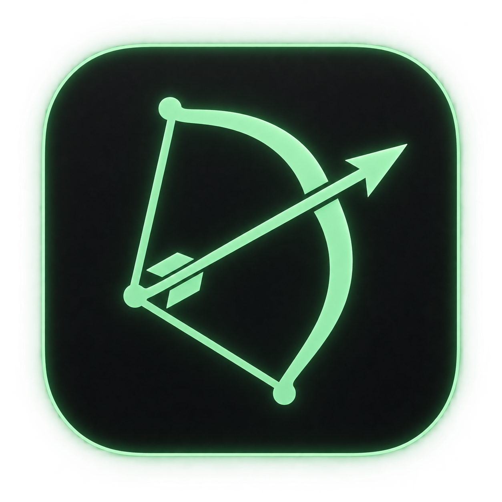

<p align="center">
  
</p>

# Nockpad

**Gather your thoughts. Take aim.**

A small, native Mac workspace for focused work: a Pomodoro timer, a Kanban board,
and a standalone jotpad, in a quiet terminal-inspired interface.

A *nock* is the notch that fits an arrow onto a bowstring. Nockpad is a place to
ready your next thought before taking aim.

## Choose your edition

The first edition is **Ram's Original**. At Ram's invitation, Codex designed four
independent experiments. These are alternatives, not a ladder of replacements.
Choose the one that suits your way of working.

| Edition | Credit | Pick this if you want… | Download |
| --- | --- | --- | --- |
| **Original · 0.1.0** | **Ram** | The balanced timer, board, and jotpad that started it all. | [Original](https://github.com/ralstonia/nockpad/releases/tag/v0.1.0) |
| **Return · 0.2.0** | **Codex** | A persistent next-step breadcrumb and a five-minute way back into focus. | [Return](https://github.com/ralstonia/nockpad/releases/tag/v0.2.0) |
| **Quiet · 0.3.0** | **Codex** | One intention, a hidden central countdown, and silent defaults. | [Quiet](https://github.com/ralstonia/nockpad/releases/tag/v0.3.0) |
| **Fieldnotes · 0.4.0** | **Codex** | A notebook-first workspace with daily pages, timestamps, and Markdown export. | [Fieldnotes](https://github.com/ralstonia/nockpad/releases/tag/v0.4.0) |
| **Rhythm · 0.5.0** | **Codex** | A seven-day session view, a personal daily target, and optional reflections. | [Rhythm](https://github.com/ralstonia/nockpad/releases/tag/v0.5.0) |

**macOS 14 or later · Apple Silicon and Intel**

Download an edition's ZIP, unzip it, and move the app to Applications. All five
can be installed side by side. Each has its own app identity, settings, tasks,
session history, and notes. There is no automatic migration or synchronization
between editions. The Original release remains available at its original tag.

**These are early, unnotarized previews.** They are ad-hoc signed, not signed with an
Apple Developer ID certificate. macOS may block the first launch. Review
[Apple's guidance on opening downloaded apps](https://support.apple.com/102445)
before deciding whether to allow an app in System Settings → Privacy & Security.

See [EDITIONS.md](EDITIONS.md) for the individual experiments and [AUTHORS.md](AUTHORS.md)
for attribution. Core features below are shared; experimental features are not cumulative.

## A workspace that stays out of the way

- **Focus timer:** focus, short breaks, and long breaks; start, pause, skip, reset,
  configurable durations, and optional automatic phase transitions.
- **Sound:** a soft tick during focus. When focus stops, a gentle ambient wash can
  take over. Resume focus and the ambient sound stops. Mute it from the footer or
  menu bar. Audio is generated locally.
- **A gentle return:** the main window can come forward when focus stops. Disable
  this in Settings if you prefer staying where you are.
- **Kanban:** Backlog → Ready → Doing → Done, drag-and-drop cards, task notes, and
  estimated/completed pomodoros.
- **Jotpad:** independent, titled notes with search, automatic local saving, word
  counts, and copying as plain text. Separate from task notes.
- **Terminal feel:** monospaced type, dark panels, green accents, square borders,
  and a text progress bar. Native mouse controls still work.
- **Menu bar:** time remaining and timer controls without opening the workspace.

## Keyboard shortcuts

| Action | Shortcut |
| --- | --- |
| Timer / Board / Jotpad | ⌘1 / ⌘2 / ⌘3 |
| Open Jotpad | ⌘⇧J |
| New jotpad note, while Jotpad is visible | ⌘⇧N |
| New task | ⌘N |
| Start / Pause | ⌘Space |
| Skip phase | ⌘⇧S |
| Reset phase | ⌘⇧R |
| Settings | ⌘, |

Double-click a board card to edit it.

## Your data

No account, telemetry, cloud sync, or app network access. Tasks and session logs
use SwiftData. Notes are saved atomically as JSON, separately from tasks.

The Original sandbox container is `~/Library/Containers/app.nockpad.mac/`. Other
editions append `.return`, `.quiet`, `.fieldnotes`, or `.rhythm` to that identity. Jotpad data lives
under its `Data/Library/Application Support/Nockpad/Jotpad.json` directory.
Back up the container if these notes or tasks matter to you. This preview has no
built-in cloud backup or migration from other apps.

If saved tasks cannot be opened, Nockpad displays an error rather than silently
switching to temporary storage. Jotpad read/write errors remain visible; unreadable
note files are preserved.

Nockpad opens with a few fictional sample cards so you can try the board. The
public source and download contain no personal tasks, notes, or settings.

## Build from source

Requires macOS, Xcode with the macOS SDK, and SwiftData/Observation support
(Xcode 15 or newer; the preview was built with Xcode 27).

```sh
git clone https://github.com/ralstonia/nockpad.git
cd nockpad
xcodebuild -project Nockpad.xcodeproj -scheme Nockpad \
  -configuration Release -destination 'platform=macOS' \
  -derivedDataPath build build
open build/Build/Products/Release/Nockpad.app
```

Or open `Nockpad.xcodeproj` in Xcode and run the Nockpad scheme.

```sh
./scripts/check.sh    # Timer/audio transitions and jotpad persistence/error checks
./scripts/package.sh return  # Build Return; also accepts original, quiet, fieldnotes, rhythm
python3 scripts/verify_packages.py  # Verify all five packaged editions once built
```

The Original 0.1.0 source is frozen at tag `v0.1.0`. The current source shares fixes
and builds all edition profiles. Each profile embeds its identity in Info.plist; it
is not an upgrade prompt or a runtime feature purchase.

The smoke check uses isolated settings and temporary notes and stubs system notifications. Audio playback
uses the Mac's audio output. Both CPU architectures are built; interactive use has
been exercised on Apple Silicon, not an Intel Mac. macOS 14 is the deployment target;
we have not tested every supported macOS version.

To regenerate app icons from the master (requires Python and Pillow):

```sh
python3 scripts/import_icon.py design/Nockpad-icon.png
```

## Preview limitations

No Apple notarization, synchronization, automatic updates, or rich-text editing.
The four Codex editions are experiments: universal builds and behavior checks pass,
but their new screens have not completed interactive visual QA on every machine.
A possible app disappearance was reported during personal use; no matching crash
report was found, so the cause remains unresolved. Please report reproducible issues
with your macOS version and steps, leaving private note/task content out of reports.

## Source and license

Source is public for inspection. No open-source license has been granted yet;
reuse permissions will be clarified in a later release. The icon was created with
AI assistance. Nockpad began as a personal app called FocusBoard.
